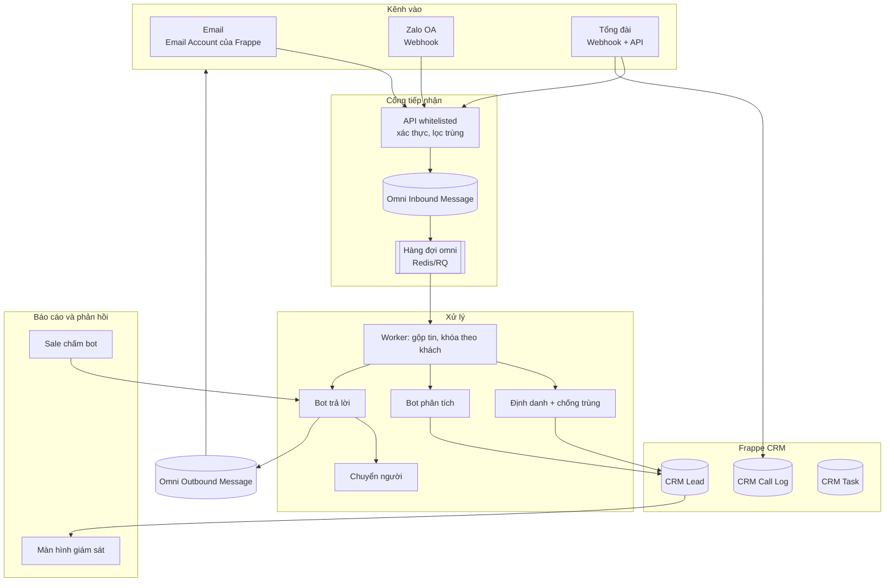
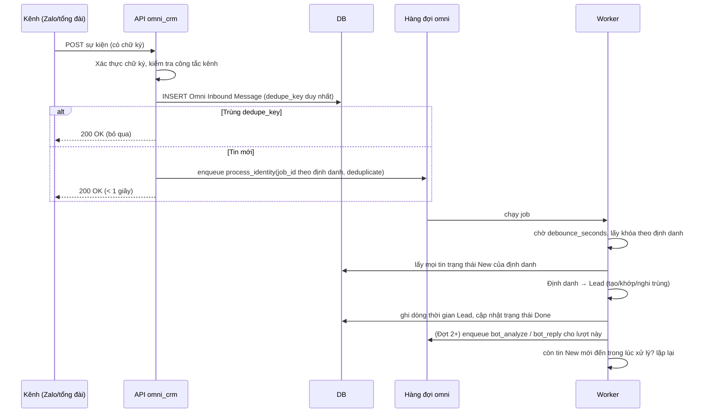

# 01 · Kiến trúc

## 1. Năm lớp



Email không đi qua API webhook mà qua Email Account có sẵn của Frappe; hook `Communication.after_insert` đưa thư vào `Omni Inbound Message`. Từ đó trở đi, mọi kênh đi chung một đường.

## 2. Luồng chính

### 2.1 Tin vào (mọi kênh)



### 2.2 Tin ra

Sale (hoặc bot ở chế độ tự động) tạo `Omni Outbound Message` → job `send_outbound` trên hàng đợi omni gọi adapter của kênh → cập nhật trạng thái Sent/Failed. Ở `sandbox_mode` adapter không gọi API mà chỉ ghi log.

### 2.3 Cuộc gọi (Đợt 2)

- Chuông reo: tổng đài gọi đồng bộ API tra cứu → trả tên, Lead, sale phụ trách trong ≤ 1 giây (đọc thẳng `Omni Identity`, không qua hàng đợi).
- Kết thúc cuộc gọi: sự kiện vào cổng như mọi tin vào (`event_type = call_ended`), worker tạo/cập nhật `Omni Call` và `CRM Call Log`; gọi nhỡ tạo `CRM Task` gọi lại.
- Ghi âm (Đợt 3): job tải file về, chuyển văn bản, bot tóm tắt.

## 3. Cấu trúc thư mục app

```
omni_crm/
├── omni_crm/
│   ├── hooks.py
│   ├── omni_crm/doctype/...          # các DocType Omni*
│   ├── api/
│   │   ├── webhooks.py               # zalo(), zalo_oauth_start/callback(), telephony_event(), telephony_lookup()
│   │   ├── inbox.py                  # Hộp thư: list_conversations, get_thread, send_reply, request_phone, duyệt nháp
│   │   └── admin.py                  # Giám sát: monitor_snapshot, reprocess, erase_customer_data
│   ├── queue.py                      # queue_for(channel_type), queue_for_identity(): MỘT chỗ định tuyến hàng đợi (V21-01)
│   ├── ingest/
│   │   ├── gateway.py                # save_inbound(), enqueue_identity()
│   │   └── events.py                 # InboundEvent, OutboundRequest, stable_message_id()
│   ├── pipeline/
│   │   ├── worker.py                 # process_identity(), _process_batch(), post_batch_hooks()
│   │   ├── outbound.py               # queue_outbound(), send_outbound()
│   │   ├── locks.py                  # identity_lock()
│   │   ├── retry.py                  # mark_retry(), redact()
│   │   └── sweeper.py                # requeue_stuck(), cleanup_raw_payloads()
│   ├── identity/
│   │   ├── normalize.py              # normalize_phone/email/sender, name_similarity, is_placeholder_name
│   │   ├── extract.py                # extract_contacts()
│   │   ├── resolver.py               # resolve(): định danh → Lead
│   │   ├── duplicates.py             # create_candidate(), dismiss(), merge() (API)
│   │   └── merge.py                  # merge_leads()
│   ├── channels/
│   │   ├── base.py                   # ChannelAdapter (interface)
│   │   ├── registry.py               # get_adapter(channel_type)
│   │   ├── email/{adapter.py, clean.py}
│   │   ├── zalo/{adapter.py, client.py, signature.py, token.py, errors.py}
│   │   ├── telephony/{base.py, adapter.py, registry.py, fake.py, stringee.py, recording.py}
│   │   ├── meta_leads/, google_leads/, web_form/   # D1-15: Lead từ quảng cáo và website
│   ├── prospect/                     # D1-13, D1-14: nhà thầu B2B
│   │   ├── fit.py                    # compute_fit(), recompute_all_fit()
│   │   ├── importer.py               # import_workbook()
│   │   └── sources/{base.py, excel.py}   # nguồn cào/API: chờ V2-Q13
│   ├── crm_bridge/
│   │   ├── lead.py                   # create_lead_for_identity(), track_manual_edits()
│   │   ├── timeline.py               # append(), append_outbound(), conversation_turns()
│   │   ├── call_log.py, task.py, notify.py
│   ├── bot/
│   │   ├── ai_client.py              # call_tool(): gọi Claude API, hạn mức, Omni Bot Run
│   │   ├── fake_client.py            # FakeAIClient cho test
│   │   ├── context.py                # build_conversation()
│   │   ├── knowledge.py              # nhập CSV, render_kb()
│   │   ├── analyze.py, reply.py, guards.py, handoff.py, scoring.py
│   │   ├── replay.py                 # chạy lại dữ liệu cũ ở chế độ ngầm
│   │   ├── auto_send.py              # Đợt 3: eligibility(), ngắt mạch
│   │   ├── prompts/                  # loader.py + analyze_v1.md, reply_v1.md, summarize_v1.md
│   │   └── eval/                     # importer.py, builder.py, run.py
│   ├── stt/{base.py, <nhà cung cấp>.py}   # Đợt 3
│   ├── monitoring/alerts.py          # luật cảnh báo, chống lặp
│   ├── utils/business_hours.py       # giờ làm việc, hạn gọi lại
│   ├── flags.py                      # đọc công tắc
│   ├── fixtures/                     # custom_field.json, property_setter.json, role.json
│   ├── patches/                      # patch tính trường chuẩn hóa cho Lead cũ…
│   └── tests/                        # fixtures/<kênh>/, load/, acceptance/, stt_trial/
└── docs/, prompts/, eval/, mau/      # từ bộ kit
```

## 4. Hợp đồng dữ liệu giữa các lớp

```python
# ingest/events.py
@dataclass(frozen=True)
class InboundEvent:
    channel: str                 # tên Omni Channel
    channel_type: str            # "Email" | "Zalo OA" | "Telephony"
    event_type: str              # "message" | "follow" | "unfollow" | "user_info" | "call_ended" | ...
    external_message_id: str     # mã duy nhất của sự kiện trên kênh
    external_sender_id: str      # Zalo user id, email người gửi, SĐT gọi đến
    received_at: datetime        # thời điểm kênh ghi nhận (giờ hệ thống nếu kênh không có)
    text: str | None             # nội dung đã làm sạch (bỏ trích dẫn, chữ ký với email)
    attachments: list[dict]      # [{"url"|"file", "name", "mime"}]
    sender_profile: dict         # tên hiển thị, SĐT/email nếu kênh cung cấp
    raw: dict                    # payload gốc, lưu nguyên văn

@dataclass(frozen=True)
class OutboundRequest:
    channel: str
    identity: str                # tên Omni Identity
    text: str
    reply_to_external_id: str | None
    source: str                  # "Sale" | "Bot" | "System"
    bot_draft: str | None = None # Omni Bot Draft nếu tin xuất phát từ nháp của bot (Đợt 3)
```

```python
# channels/base.py
class ChannelAdapter(Protocol):
    channel_type: str
    def verify_request(self, raw_body: bytes, headers: dict, channel_doc) -> bool: ...
    def parse(self, raw_body: bytes, headers: dict, channel_doc) -> list[InboundEvent]: ...
    def send(self, req: OutboundRequest, channel_doc) -> str: ...   # trả external_message_id
    def can_send_now(self, identity_doc, channel_doc) -> tuple[bool, str]: ...  # (được gửi?, lý do)
```

## 5. Hàng đợi và tác vụ định kỳ

| Tên | Loại | Việc |
| --- | --- | --- |
| `omni` | hàng đợi riêng | process_identity của email/Zalo/tổng đài, send_outbound, bot_*, tải ghi âm, nhập danh sách |
| `omni_leads` | hàng đợi riêng (V21-01) | process_identity của lead quảng cáo (Meta Lead Ads, Google Lead Form, Web Form): xử lý tin, gọi Graph API, giao sale, thông báo |
| mỗi 5 phút | scheduler | `pipeline.sweeper.requeue_stuck` — tin kẹt, tin chờ thử lại |
| mỗi 30 phút | scheduler | `channels.zalo.token.refresh_if_needed` |
| hằng đêm 01:30 | scheduler | `channels.telephony.registry.reconcile_yesterday` (Đợt 2) |
| hằng đêm 02:00 | scheduler | `pipeline.sweeper.cleanup_raw_payloads` theo thời hạn lưu |
| mỗi giờ | scheduler | `bot.ai_client.report_budget` (Đợt 2) |
| mỗi 5 phút | scheduler | `monitoring.alerts.run_checks` |

Cấu hình worker riêng trong `common_site_config.json` (xác nhận cú pháp với bench v15 đang dùng):

```json
"workers": {
  "omni": { "timeout": 600, "background_workers": 8 },
  "omni_leads": { "timeout": 600, "background_workers": 2 }
}
```

Việc chọn hàng đợi nằm ở `omni_crm/queue.py::queue_for(channel_type)`; không ghi cứng tên hàng đợi ở nơi khác. Thiếu `omni_leads` trong `workers` thì lead quảng cáo rơi về `omni` (ghi cảnh báo tối đa một lần mỗi giờ, không lỗi).

## 6. Hook

```python
# hooks.py (khung)
doc_events = {
    "Communication": {"after_insert": "omni_crm.channels.email.adapter.on_communication_insert"},
    "CRM Lead": {
        "validate": "omni_crm.crm_bridge.lead.compute_normalized_fields",   # D1-05, docs/04 mục 4
        "on_update": "omni_crm.crm_bridge.lead.track_manual_edits",        # D1-06
    },
}
scheduler_events = {
    "cron": {
        "*/5 * * * *": [
            "omni_crm.pipeline.sweeper.requeue_stuck",
            "omni_crm.monitoring.alerts.run_checks",
        ],
        "*/30 * * * *": ["omni_crm.channels.zalo.token.refresh_if_needed"],
        "30 1 * * *": ["omni_crm.channels.telephony.registry.reconcile_yesterday"],
        "0 2 * * *": ["omni_crm.pipeline.sweeper.cleanup_raw_payloads"],
    },
    "hourly": ["omni_crm.bot.ai_client.report_budget"],
}
fixtures = [
    {"dt": "Custom Field", "filters": [["module", "=", "Omni CRM"]]},
    {"dt": "Property Setter", "filters": [["module", "=", "Omni CRM"]]},
]
```

## 7. Bảo mật

- Webhook là API `allow_guest=True`, chỉ nhận `POST`, **bắt buộc** xác thực chữ ký hoặc token bí mật của kênh; sai thì trả 401 và ghi một dòng log rút gọn (không ghi payload).
- Giới hạn kích thước body 1 MB.
- Ghi âm và tệp đính kèm lưu dạng **private file**; chỉ người xem được Lead mới mở được.
- Quyền: role `Omni Admin` (cấu hình, giám sát), `Sales User` của CRM (đọc hội thoại, gửi trả lời, duyệt nháp), `Omni Knowledge Editor` (sửa kho tri thức).
