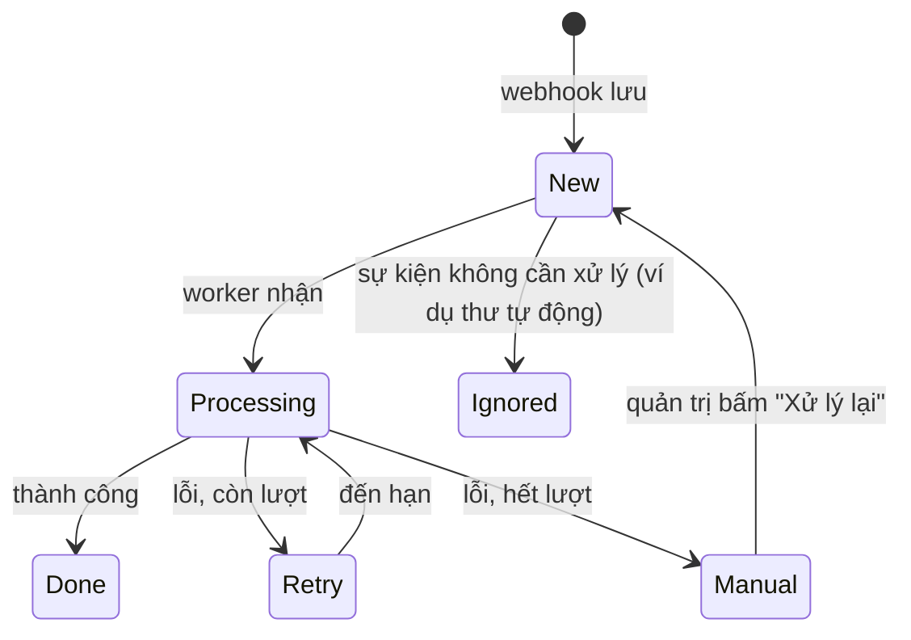

# 03 · Cổng tiếp nhận và hàng đợi

Mục tiêu duy nhất của lớp này: **không mất tin, không xử lý trùng, không để một lỗi làm tắc cả hệ thống.**

## 1. API webhook

| Endpoint | Kênh | Ghi chú |
| --- | --- | --- |
| `POST /api/method/omni_crm.api.webhooks.zalo?ch=<channel_name>` | Zalo OA | Xác thực chữ ký Zalo |
| `POST /api/method/omni_crm.api.webhooks.telephony_event?ch=<channel_name>&t=<webhook_token>` | Tổng đài | Đợt 2 |
| `GET/POST /api/method/omni_crm.api.webhooks.telephony_lookup?ch=...&t=...` | Tổng đài | Đồng bộ, Đợt 2 |

Khung xử lý chung cho mọi webhook (trong `api/webhooks.py`, gọi xuống `ingest/gateway.py`):

1. Chỉ nhận đúng method; body > 1 MB → 413.
2. Đọc **raw body** (`frappe.request.get_data()`) trước khi parse — chữ ký tính trên raw body.
3. Tải `Omni Channel` theo `ch`; không có hoặc sai `channel_type` → 404.
4. `adapter.verify_request(raw, headers, channel)`; sai → 401, ghi Error Log rút gọn (không payload, không header bí mật).
5. `events = adapter.parse(raw, headers, channel)` — có thể 0, 1 hoặc nhiều sự kiện. Lỗi parse → **vẫn lưu** một bản ghi `event_type = "unparsed"`, `status = Manual`, rồi trả 200 (để kênh không gửi lại vô hạn), và cảnh báo.
6. Với mỗi sự kiện: `gateway.save_inbound(event)`.
7. `frappe.db.commit()` rồi trả 200. Toàn bộ bước 1–7 phải dưới **1 giây** ở p95 (Zalo yêu cầu phản hồi trong 5 giây).

Không gọi AI, không gọi API ngoài, không tạo Lead trong request webhook.

### 1b. Hàng đợi `omni` và `omni_leads` (V21-01)

Hàm duy nhất `omni_crm/queue.py::queue_for(channel_type)` chọn hàng đợi; `queue_for_identity(identity_key)` lấy loại kênh từ phần trước dấu `:` đầu tiên của `identity_key`.

| Loại kênh | Hàng đợi |
| --- | --- |
| Meta Lead Ads, Google Lead Form, Web Form | `omni_leads` |
| Email, Zalo OA, Telephony, bot (`analyze_batch`, `reply_batch`), tin ra, nhập danh sách | `omni` |

- `job_id` (`omni-identity::{identity_key}`), `deduplicate`, khóa Redis theo định danh (`omni:lock:{identity_key}`), khóa theo SĐT/email (`sig:`) và debounce **không đổi**: tách hàng đợi không làm thay đổi cách chống xử lý chồng. Một khách vừa điền form (`omni_leads`) vừa nhắn Zalo (`omni`) có hai định danh khác nhau; hai worker khác hàng đợi vẫn tuần tự qua khóa `sig:<SĐT/email>` và ra đúng một Lead (test `test_v21_01_queue`).
- Tác vụ quét `requeue_stuck`, nút "Xử lý lại" (`reprocess`) và job tiếp nối của worker đều đi qua `enqueue_identity`, nên dùng cùng hàm định tuyến. Đối soát Meta tạo tin qua `save_inbound` nên cũng vậy.
- Thiếu khai báo `omni_leads` trong khóa `workers` (`common_site_config.json`) thì `queue_for` trả `omni` và ghi cảnh báo "chưa khai báo hàng đợi omni_leads" tối đa một lần mỗi giờ (khóa Redis `omni:queue:leads_missing_warned`); không lỗi, lead vẫn được xử lý nhưng lại dùng chung worker với chat. **Khai báo mà không có worker lắng nghe thì việc nằm chờ**: luôn khai báo kèm worker (docs/huong-dan/01 mục 3).
- Lưu ý: cấu hình `workers` được Frappe đọc một lần mỗi tiến trình (`lru_cache`); đổi cấu hình phải khởi động lại gunicorn, worker và scheduler.

## 2. `gateway.save_inbound(event) -> str | None`

```text
dedupe_key = f"{event.channel}:{event.external_message_id}"
identity_key = f"{event.channel_type}:{normalize_sender(event.channel_type, event.external_sender_id)}"
try:
    insert Omni Inbound Message(status=New, identity_key=identity_key, ...)   # ignore_permissions=True
except DuplicateEntryError / UniqueValidationError:
    return None                                         # đã nhận rồi → bỏ qua, không enqueue
if not flags.channel_enabled(event.channel):
    return name                                         # chỉ lưu, không xử lý
frappe.enqueue(
    "omni_crm.pipeline.worker.process_identity",
    queue=queue_for_identity(identity_key),             # "omni_leads" cho lead quảng cáo, còn lại "omni" (mục 1b)
    job_id=f"omni-identity::{identity_key}",
    deduplicate=True,                                   # đã có job chờ cho khách này thì không thêm
    enqueue_after_commit=True,
    identity_key=identity_key,
)
return name
```

- `external_message_id` phải ổn định: lấy từ mã tin của kênh (Zalo `message.msg_id`, `Message-ID` email, `call_id` tổng đài). Kênh không có mã: băm SHA-256 của (`channel`, `sender`, `timestamp`, `text`).
- Xác nhận `job_id` + `deduplicate` hoạt động trên Frappe v15 đang cài (đọc `frappe/utils/background_jobs.py`). Nếu không, dùng khóa Redis `SET NX` ngắn hạn làm cờ "đã có job chờ".

## 3. Worker `process_identity(identity_key)`

```text
sleep(debounce_seconds)                                  # gom tin khách gõ liên tiếp
with identity_lock(identity_key, timeout=120s):          # khóa Redis, xem mục 4
    loop tối đa 5 vòng:
        msgs = Inbound where Inbound.identity_key = identity_key AND status IN (New, Retry đến hạn)
               ORDER BY received_at
        if not msgs: break
        batch_id = uuid
        đánh dấu msgs: status=Processing, processing_started_at=now, batch_id; commit
        try:
            identity = resolver.resolve(msgs)            # tạo/khớp Omni Identity + Lead (docs/04)
            timeline.append(lead, msgs)                  # ghi dòng thời gian (docs/05, 06)
            đánh dấu msgs Done, gắn identity, lead; cập nhật last_inbound_at; commit
            hậu xử lý theo công tắc (Đợt 2+): post_batch_hooks(batch_id, lead)
                # bot phân tích bật → enqueue analyze_batch; analyze_batch xong mới enqueue reply_batch
                # bot phân tích tắt nhưng bot trả lời bật → enqueue reply_batch trực tiếp
                # (tránh chạy đua: chốt chặn của bot trả lời cần kết quả phân tích)
        except TransientError as e:                      # mạng, khóa DB, timeout
            rollback; mark_retry(msgs, e); commit
        except Exception as e:                           # lỗi dữ liệu/logic
            rollback; mark_retry(msgs, e, permanent_hint=True); commit
            log Error Log có batch_id
```

Yêu cầu:

- **Chạy lại an toàn (idempotent)**: xử lý lại một tin đã Done không tạo thêm Lead, không ghi thêm dòng thời gian. Dòng thời gian khóa theo `Omni Inbound Message.name` (custom field `omni_inbound_message` trên bản ghi dòng thời gian — `docs/02` mục 15).
- Không giữ khóa DB trong lúc gọi API ngoài.
- Job phải dừng gọn khi công tắc kênh bị tắt giữa chừng: tin chưa xử lý giữ nguyên New.

## 4. Khóa theo định danh

- Dùng khóa Redis của cache Frappe (`frappe.cache` là client Redis; xác nhận cú pháp v15: `frappe.cache.lock(name, timeout=...)` hay `frappe.cache().lock(...)`).
- Tên khóa: `omni:lock:{identity_key}`; timeout 120 giây; chờ lấy khóa tối đa 30 giây, không lấy được thì **không** enqueue lại chính job: Frappe v15 không có enqueue trì hoãn và `deduplicate` chặn job cùng `job_id` đang chạy (ADR 0001). Tin giữ `New`; lượt đang giữ khóa kiểm tra lại tin `New`/`Retry` đến hạn ở mỗi vòng và đẩy job tiếp nối sau khi nhả khóa; tác vụ quét 5 phút đẩy lại tin `New` cũ hơn 2 phút. Trường hợp xấu nhất chậm ~7 phút (đã đo).
- Khi hai định danh khác nhau cùng trỏ một Lead (ví dụ Zalo và email của cùng người), có thể xảy ra ghi đồng thời vào Lead: các thao tác ghi Lead dùng `doc.save()` với kiểm tra `modified` của Frappe; gặp `TimestampMismatchError` thì coi là TransientError.

## 5. Thử lại

| Lỗi ở lần thử | Trạng thái sau lỗi | Lần chạy kế |
| --- | --- | --- |
| 1 | Retry | +1 phút (`retry_backoff_minutes[0]`) |
| 2 | Retry | +5 phút (`retry_backoff_minutes[1]`) |
| 3 (= `max_attempts`) | Manual | Không tự chạy; cảnh báo quản trị |

Lấy từ `Omni Settings.max_attempts` (mặc định 3) và `retry_backoff_minutes` (mặc định "1,5"). Áp dụng cho cả tin vào và tin ra. Tin Retry đến hạn được tác vụ quét đưa lại hàng đợi.

## 6. Tác vụ quét `requeue_stuck` (mỗi 5 phút)

1. Tin `Processing` có `processing_started_at` cũ hơn `stuck_after_minutes` → về `Retry`, `attempts + 1`.
2. Tin `Retry` có `next_attempt_at <= now` → enqueue `process_identity` cho định danh tương ứng.
3. Tin `New` cũ hơn 2 phút mà không có job chờ (worker từng chết, Redis từng mất) → enqueue lại.
4. Tin ra `Queued` có `next_attempt_at <= now` (đang chờ thử lại), hoặc `Queued` cũ hơn 5 phút mà không có job → enqueue `send_outbound` lại (job_id theo tên tin ra nên không gửi trùng).
5. Ghi số lượng từng loại vào cache để màn hình giám sát hiển thị.

## 7. Trạng thái tin vào



## 8. Chiều ra

`send_outbound(outbound_name)` trên hàng đợi `omni`:

1. Kiểm tra công tắc `outbound_enabled` của kênh; tắt → `Blocked`.
2. `adapter.can_send_now(identity, channel)`; không được (ví dụ quá khung Zalo) → `Blocked` + lý do; báo người gửi.
3. `sandbox_mode` bật → `Sent`, `is_sandbox = 1`, không gọi API.
4. Gọi `adapter.send()`; thành công → `Sent`, lưu `external_message_id`; lỗi tạm thời → thử lại theo bảng mục 5; lỗi vĩnh viễn (ví dụ người dùng chặn OA) → `Failed` + lý do đọc được.
5. Ghi tin ra vào dòng thời gian Lead.

`job_id = f"omni-out::{outbound_name}"` để không gửi trùng khi enqueue hai lần.

## Ghi chú D1-05: worker không còn rollback toàn lô

`resolver.resolve` commit khi còn giữ khóa tín hiệu SĐT/email (ADR 0003). Vì vậy `Omni Identity` và `CRM Lead` vừa tạo được giữ lại dù bước sau của lô (ghi dòng thời gian, đánh dấu Done) lỗi; lô thử lại sẽ dùng lại chúng (không tạo trùng). Chỉ phần còn lại của lô được rollback.

## Ghi chú V2-05

`_handle_webhook(channel_type, *, max_bytes=MAX_BODY_BYTES, guard=None)`: `max_bytes` là giới hạn kích thước riêng của kênh (Web Form 64 KB), `guard(channel_doc)` là kiểm tra thêm sau khi tải kênh (giới hạn tần suất theo IP của Web Form, trả 429). Ba webhook mới: `meta_leads` (GET handshake trả `hub.challenge` nguyên văn; POST kiểm `X-Hub-Signature-256`), `google_leads` (trả `{}` mã 200; 401 sai `google_key`; 503 khi hết hạn chờ khóa DB), `web_form` (Guest). Sự kiện `form_lead` dùng mã lead của nền tảng làm `external_sender_id`; adapter có `prepare_batch` (lấy dữ liệu Meta, bỏ biểu mẫu tắt) và `after_resolve` (quy kết chiến dịch, giao sale).


## Ghi chú V21-04: webhook không làm mất tin khi chờ khóa

- **Lưu tin chỉ chèn một bản ghi.** `gateway.save_inbound` đặt tên bằng `new_inbound_name()` (`OIN-<năm>-<micro giây><3 số>`), không dùng bộ đếm `tabSeries` (nguyên nhân mọi webhook xếp hàng, xem ADR 0014). Chống trùng chỉ bằng ràng buộc duy nhất `dedupe_key`: trùng = đã nhận, trả thành công của kênh. Webhook không khóa dòng nào khác ngoài dòng vừa chèn (và dấu `last_success_at`, tối đa 1 lần/phút, chờ khóa thì bỏ qua).
- **Hàng dự phòng.** Sau khi xác thực, nếu parse/lưu gặp hết hạn chờ khóa (`omni_webhook_lock_wait_seconds`, mặc định 3 giây), bế tắc hoặc mất kết nối DB: rollback, ghi payload thô vào `private/omni_spool` (`ingest/spool.py`) và vẫn trả thành công của kênh. Tác vụ quét `omni_crm.ingest.spool.drain` (cron mỗi phút) kiểm lại seal và chữ ký, chèn vào `Omni Inbound Message` (trùng `dedupe_key` thì bỏ qua), xóa dòng đã chèn; chèn lỗi thì giữ lại.
- **Chỉ trả 5xx khi DB và hàng dự phòng cùng hỏng** (hoặc công tắc `webhook_spool_disabled` bật): log mức nghiêm trọng, cảnh báo ngay (`webhook_spool_hong`), 503.
- Giám sát: `spool_count()`, `oldest_age_seconds()`, thẻ "Hàng dự phòng webhook", cảnh báo `webhook_spool_cu` khi có tin nằm quá 10 phút.
