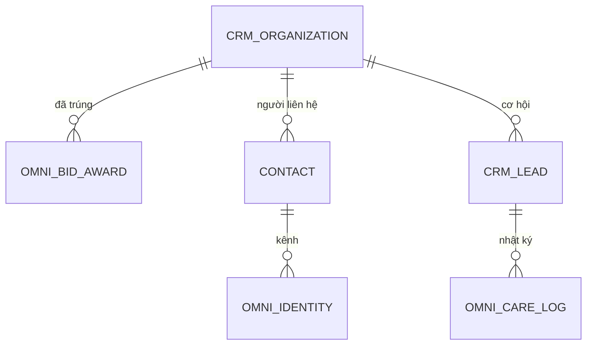

# 14 · Mô hình khách hàng nhà thầu (B2B)

Khách hàng mục tiêu là **nhà thầu (tổng thầu) đã trúng gói cung cấp vật tư y tế, hóa chất cho bệnh viện** qua mua sắm công. Sản phẩm là **dịch vụ vận hành hợp đồng SPD**: Miyano nhận đơn gọi hàng của bệnh viện, mua hàng, thanh toán nhà cung cấp, quản lý công nợ, thanh toán back-to-back theo hợp đồng giữa nhà thầu và bệnh viện. Có hai gói: **Gói Điều phối** và **Gói Trọn gói** (thêm quản lý tồn, kho, vận chuyển tới bệnh viện).

Tệp này **bổ sung và thay thế** các giả định "khách lẻ nhắn tin" ở các tài liệu khác khi có mâu thuẫn. Kênh vào, cổng tiếp nhận, bot vẫn giữ nguyên; thay đổi nằm ở **đối tượng khách**, **nguồn Lead** và **cách chấm điểm**.

## 1. Mô hình dữ liệu

| Khái niệm | Lưu ở đâu | Ghi chú |
| --- | --- | --- |
| Nhà thầu (công ty) | **CRM Organization** của app `crm` + custom field `omni_*` | Khóa nghiệp vụ: mã số thuế. Agent xác nhận tên DocType và trường có sẵn (G1, bổ sung G14) |
| Cơ hội bán dịch vụ | **CRM Lead** (một Lead đang mở cho mỗi nhà thầu), chuyển thành **CRM Deal** khi vào giai đoạn Đề xuất gói | Lead trỏ tới Organization |
| Người liên hệ | **Contact** gắn Organization; vai trò lưu ở custom field | Một nhà thầu nhiều người |
| Gói thầu đã trúng | DocType mới **Omni Bid Award** | Dữ liệu chấm điểm và mở lời |
| Đồng ý nhận liên hệ | Custom field trên Contact | Mục 6 |

### 1.1 Custom field trên CRM Organization

| fieldname | Kiểu | Ghi chú |
| --- | --- | --- |
| `omni_tax_id` | Data, search_index, **duy nhất** (ràng buộc ở mức DB nếu CRM cho phép; nếu không, kiểm tra trong `validate`) | Mã số thuế 10 hoặc 13 số, lưu dạng chữ, bỏ khoảng trắng và gạch |
| `omni_short_name` | Data | Tên viết tắt |
| `omni_address`, `omni_province` | Small Text, Data | Nếu CRM chưa có trường địa chỉ phù hợp |
| `omni_region` | Select | Miền Bắc / Miền Trung / Miền Nam |
| `omni_company_phone`, `omni_company_email` | Data | Liên hệ chung của công ty (không phải dữ liệu cá nhân) |
| `omni_revenue_bn`, `omni_revenue_year` | Float, Int | Chỉ khi có nguồn công khai |
| `omni_accounting_software` | Select | MISA / Fast / Bravo / Excel / Phần mềm khác / Chưa rõ |
| `omni_est_item_count` | Int | Số mã hàng ước tính nếu biết |
| `omni_data_source`, `omni_collected_on` | Data, Date | Nguồn danh sách |
| `omni_interested_package` | Select | Chưa rõ / Gói Điều phối / Gói Trọn gói |
| `omni_awards_in_period`, `omni_hospital_count`, `omni_max_items`, `omni_items_for_scoring`, `omni_award_value_bn`, `omni_active_awards` | Int / Float (chỉ đọc) | Kết quả tính từ Omni Bid Award (mục 3) |
| `omni_meets_criteria` | Check (chỉ đọc) | Đạt tiêu chí bắt buộc |
| `omni_fit_score` | Int (chỉ đọc) | Điểm phù hợp 0–100 |
| `omni_fit_tier` | Select A/B/C (chỉ đọc) | Hạng |
| `omni_fit_computed_at` | Datetime (chỉ đọc) | |
| `omni_verified` | Check | Bỏ trống = "chưa xác minh" (tạo từ thông tin khách tự khai trên form); sale xác minh mã số thuế rồi tích |

### 1.2 DocType Omni Bid Award

| Trường | Kiểu | Ghi chú |
| --- | --- | --- |
| `organization` | Link CRM Organization | Bắt buộc |
| `tax_id` | Data | Sao chép để đối chiếu khi nhập |
| `notice_no` | Data | Số TBMT |
| `package_name` | Small Text | |
| `hospital` | Data, chỉ mục | Tên bệnh viện/bên mời thầu, chuẩn hóa (mục 2.2) |
| `hospital_key` | Data, chỉ mục (chỉ đọc) | Tên đã chuẩn hóa để đếm bệnh viện khác nhau |
| `hospital_province` | Data | |
| `category` | Select | VTYT tiêu hao / Hóa chất – sinh phẩm / Thuốc / Trang thiết bị / Khác |
| `award_date` | Date | Ngày phê duyệt KQLCNT |
| `award_value` | Currency (VND) | |
| `item_count` | Int | Số mã hàng trúng |
| `duration_months` | Int | Thời gian thực hiện hợp đồng |
| `end_date` | Date (chỉ đọc) | `award_date + duration_months` |
| `role` | Select | Nhà thầu độc lập / Liên danh – đứng đầu / Liên danh – thành viên |
| `source_url` | Data | Đường dẫn trang kết quả |
| `hospital_raw_key` | Data (chỉ đọc) | Tên bệnh viện chuẩn hóa **trước** khi áp bảng Omni Hospital Alias (chỉ bỏ dấu, chữ thường, khoảng trắng, tiền tố) |
| `import_key` | Data, **duy nhất** | `tax_id|notice_no|hospital_raw_key` (khi thiếu `notice_no`: `tax_id|hospital_raw_key|award_date|award_value`) — dùng tên trước khi gộp alias để sửa alias không làm nhập lại tạo trùng |

### 1.3 Custom field trên Contact

| fieldname | Kiểu | Ghi chú |
| --- | --- | --- |
| `omni_contact_role` | Select | Người quyết định / Phụ trách đấu thầu / Kế toán – công nợ / Mua hàng / Khác |
| `omni_info_source` | Data | Lấy thông tin từ đâu — **bắt buộc** khi nhập |
| `omni_has_zalo` | Select | Có / Không / Chưa rõ |
| `omni_consent` | Select | Có / Chưa hỏi / Từ chối |
| `omni_consent_date`, `omni_consent_method` | Date, Data | Bằng chứng đồng ý |

Liên kết Contact với kênh: khi SĐT/email của Contact khớp một `Omni Identity`, Identity được gắn Lead của Organization (xem mục 2).

## 2. Định danh và chống trùng — thứ tự mới

1. **Mã số thuế** (Organization): nhập danh sách hoặc khách cung cấp → khớp chắc chắn.
2. **SĐT/email của Contact đã biết** thuộc Organization → gắn Lead đang mở của Organization đó.
3. **Tên miền email công ty** (`@congty.vn`, không tính gmail, yahoo, outlook…) khớp `website`/`omni_company_email` của đúng **một** Organization → tín hiệu trung bình: gắn và tạo nghi trùng nếu có mâu thuẫn tên.
4. Các quy tắc ở `docs/04` cho người gửi chưa biết.

Khách lạ nhắn vào (chưa biết công ty): tạo Lead như cũ, bot/sale hỏi tên công ty hoặc mã số thuế; khi có, liên kết Organization (tạo mới nếu chưa có) và gộp với Lead sẵn có của Organization theo `docs/04` mục 5.

### 2.1 Chuẩn hóa mã số thuế

Bỏ khoảng trắng, dấu chấm; giữ dạng `0123456789` hoặc `0123456789-001` (chi nhánh). Kiểm tra độ dài 10 hoặc 13 (dạng `10 số-3 số`); sai thì từ chối dòng khi nhập và báo lý do.

### 2.2 Chuẩn hóa tên bệnh viện

`hospital_key` = chữ thường, bỏ dấu, bỏ khoảng trắng thừa và dấu câu, thay các tiền tố đồng nghĩa (`bv` → `benh vien`, `bvdk` → `benh vien da khoa`, `ttyt` → `trung tam y te`). Có bảng ánh xạ tay (DocType nhỏ **Omni Hospital Alias**: `alias_key` → `canonical_name`) để gộp tên viết khác của cùng một bệnh viện; màn hình quản trị liệt kê các tên gần giống (độ giống ≥ 0.85) để người duyệt gộp.

## 3. Chấm điểm hai trục

### 3.1 Điểm phù hợp (fit) — tính bằng code, không dùng AI

Cùng công thức với mẫu Excel `mau/Mau_DanhSach_NhaThau_TiemNang.xlsx` (sheet HuongDan, ThamSo) để số trong CRM khớp số trong file:

- Chỉ tính gói có `category` thuộc danh sách tính điểm (mặc định VTYT tiêu hao, Hóa chất – sinh phẩm) và `award_date` trong `fit_period_months` (mặc định 24) tính tới ngày tính.
- `hospital_count` = số `hospital_key` khác nhau; `max_items` = `item_count` lớn nhất; `items_for_scoring` = max(`omni_est_item_count`, `max_items`); `award_value_bn` = tổng giá trị / 10⁹ — cả bốn chỉ tính gói trong kỳ và đúng loại hàng. `active_awards` = số gói đúng loại hàng có `end_date` ≥ ngày tính (**không** lọc theo kỳ, giống mẫu Excel).
- Làm tròn kiểu Excel (`Decimal` với `ROUND_HALF_UP`, không dùng `round()` của Python); cộng tháng bằng `dateutil.relativedelta` (giống EDATE: ngày 31 cộng 1 tháng về ngày cuối tháng).
- **Tiêu chí bắt buộc**: `hospital_count ≥ fit_min_hospitals` (5) **và** `items_for_scoring ≥ fit_min_items` (200).
- `fit_score` = round(W_BV·min(1, BV/BV_max) + W_MH·min(1, MH/MH_max) + W_GT·min(1, GT/GT_max) + W_HL·[active_awards > 0]). Mặc định BV_max 10, MH_max 500, GT_max 20 tỷ, trọng số 40/30/20/10.
- Hạng: A = đạt tiêu chí và điểm ≥ `fit_tier_a` (70); B = đạt tiêu chí; C = chưa đạt.
- Tính lại khi Omni Bid Award hoặc trường Organization liên quan thay đổi, và hằng đêm (vì ngày tính thay đổi).

Tham số lưu trong Omni Settings: `fit_period_months`, `fit_min_hospitals`, `fit_min_items`, `fit_max_hospitals`, `fit_max_items`, `fit_max_value_bn`, `fit_w_hospitals`, `fit_w_items`, `fit_w_value`, `fit_w_active`, `fit_tier_a`, `fit_categories` (Small Text, mỗi dòng một loại hàng).

### 3.2 Điểm quan tâm (engagement)

Là `omni_score` hiện có (`docs/08` mục 4), dùng bảng tín hiệu B2B (`mau/bang-diem-lead-b2b-mau.csv`): phản hồi lần đầu, đã trao đổi nhu cầu, hỏi về gói dịch vụ, hỏi phí, yêu cầu đề xuất, có người quyết định tham gia, số lần liên hệ 30 ngày.

### 3.3 Ưu tiên liên hệ

| | Quan tâm thấp | Quan tâm cao |
| --- | --- | --- |
| **Phù hợp A/B** | Ưu tiên gọi chủ động | Nóng: báo sale ngay, mục tiêu đề xuất gói |
| **Phù hợp C** | Nuôi dưỡng nhẹ, không gọi | Tư vấn, kiểm tra lại dữ liệu gói thầu |

Dashboard Tổng quan thêm danh sách **"Phù hợp A/B, chưa liên hệ"** sắp theo điểm phù hợp.

## 4. Giai đoạn bán hàng

CRM Lead Status / CRM Deal Status tạo bằng fixtures hoặc patch (là dữ liệu, không sửa code `crm`):

| Giai đoạn | Ở đâu | Điều kiện chuyển |
| --- | --- | --- |
| Tiềm năng | Lead | Có trong danh sách, chưa liên hệ |
| Đã liên hệ | Lead | Có ít nhất một phiên chăm sóc với nhà thầu |
| Đã trao đổi nhu cầu | Lead | Đã nói chuyện với người phụ trách, biết gói đang thực hiện và vướng mắc |
| Đề xuất gói | Deal | Đã gửi đề xuất Gói Điều phối/Trọn gói |
| Đàm phán | Deal | |
| Ký hợp đồng | Deal (Won) | |
| Không phù hợp | Lead/Deal (Lost) | Ghi lý do: không có nhu cầu, đã tự vận hành, quy mô nhỏ, khác |

Agent xác nhận cách CRM lưu trạng thái và cách chuyển Lead → Deal trước khi tạo (G14). Lý do "Không phù hợp": dùng trường lý do mất của CRM nếu có; nếu không, custom field `omni_lost_reason` (Select: Không có nhu cầu / Đã tự vận hành / Quy mô nhỏ / Không liên lạc được / Khác) trên CRM Lead và CRM Deal.

## 5. Nguồn Lead và nhập danh sách

1. **Danh sách từ dữ liệu đấu thầu công khai**: kết quả lựa chọn nhà thầu tra cứu trên Hệ thống mạng đấu thầu quốc gia (muasamcong.mpi.gov.vn); dịch vụ DauThau.info có gói API trả phí. **Không viết công cụ thu thập tự động trang muasamcong trước khi pháp chế xác nhận điều khoản sử dụng** (V2-Q13). Giai đoạn đầu: IT đổ dữ liệu vào mẫu Excel, hệ thống nhập file.
2. **Nhập file** (`omni_crm.prospect.importer`): đọc đúng mẫu Excel (tên sheet và mã trường dòng 2). Theo thứ tự: NhaThau → upsert Organization theo mã số thuế; GoiThau → upsert Omni Bid Award theo `import_key`; NguoiLienHe → upsert Contact theo (Organization, SĐT chuẩn hóa hoặc email). Bỏ dòng 3 (ví dụ). Tạo Lead trạng thái Tiềm năng cho Organization chưa có Lead đang mở, người phụ trách = cột `owner_email` (không có thì theo quy tắc phân công). Tính điểm phù hợp. Kết quả: báo cáo số dòng tạo mới/cập nhật/bỏ qua/lỗi, kèm tệp lỗi để sửa và nhập lại. Nhập lại cùng file không tạo trùng.
   **Ánh xạ mã trường trong file → CRM:**

   | Sheet | Mã trường | Đích |
   | --- | --- | --- |
   | NhaThau | `tax_id`, `name`, `short_name`, `address`, `province`, `region`, `website`, `company_phone`, `company_email` | CRM Organization: `omni_tax_id`, tên tổ chức (trường có sẵn của CRM), `omni_short_name`, `omni_address`, `omni_province`, `omni_region`, website (trường có sẵn), `omni_company_phone`, `omni_company_email` |
   | NhaThau | `annual_revenue_bn`, `revenue_year`, `accounting_software`, `est_item_count`, `data_source`, `collected_on`, `interested_package` | `omni_revenue_bn`, `omni_revenue_year`, `omni_accounting_software`, `omni_est_item_count`, `omni_data_source`, `omni_collected_on`, `omni_interested_package` |
   | NhaThau | `owner_email`, `stage` | Người phụ trách và trạng thái của CRM Lead. `stage` thuộc giai đoạn Lead (Tiềm năng, Đã liên hệ, Đã trao đổi nhu cầu) → đặt cho Lead; giai đoạn Deal (Đề xuất gói, Đàm phán, Ký hợp đồng) → tạo Lead rồi chuyển Deal bằng hàm chuyển đổi của CRM; "Không phù hợp" → Lead trạng thái mất, `omni_lost_reason` = Khác, ghi chú "Nhập từ file" |
   | NhaThau | `notes` | Một CRM Note trên Lead ("Ghi chú khi nhập danh sách") — chỉ tạo khi nội dung khác lần nhập trước |
   | GoiThau | mọi cột nhập | Omni Bid Award cùng tên trường |
   | NguoiLienHe | `full_name` | Contact: tách họ và tên theo cách CRM/Frappe lưu (tên = từ cuối, họ = phần còn lại) |
   | NguoiLienHe | `title`, `contact_role`, `phone`, `email`, `has_zalo`, `info_source`, `consent`, `consent_date`, `consent_method` | Contact: chức danh (trường có sẵn), `omni_contact_role`, số điện thoại và email (bảng con có sẵn của Contact), `omni_has_zalo`, `omni_info_source`, `omni_consent`, `omni_consent_date`, `omni_consent_method` |
   | NguoiLienHe | `notes` | Comment trên Contact |
   | (mọi sheet) | `calc_*` | Không nhập; dùng để đối chiếu (D1-14) |

   Trường bắt buộc: NhaThau `tax_id`, `name`; GoiThau `tax_id`, `hospital`, `category`, `award_date`; NguoiLienHe `tax_id`, `full_name`, `info_source`.

3. **Nguồn API** (để sau, khi công ty mua gói dữ liệu): interface `BidDataSource.fetch_awards(since) -> list[AwardRecord]`, cài đặt đầu tiên `ExcelSource`; thêm `DauThauApiSource` khi có hợp đồng.
4. **Inbound**: nhà thầu tự liên hệ qua website (LeadForm của bộ nhận diện), Zalo, email, hotline — đi qua cổng tiếp nhận như cũ, rồi liên kết Organization (mục 2).

## 6. Liên hệ chủ động và tuân thủ

- Thông tin người liên hệ là dữ liệu cá nhân: bắt buộc `omni_info_source`, phân quyền theo Lead, xóa được theo yêu cầu — mở rộng thao tác "Xóa dữ liệu khách" (`docs/11` mục 6) sang **Contact**: xóa họ tên, SĐT, email, ghi chú, đặt `omni_consent = Từ chối` và giữ bản ghi ẩn danh để lần nhập sau không tạo lại người này (khớp theo băm SĐT/email).
- Nghị định 91/2020/NĐ-CP: tin nhắn, thư điện tử, cuộc gọi **quảng cáo** chỉ được gửi khi người nhận đã đồng ý trước, và phải kiểm tra danh sách không quảng cáo. Cách áp dụng cho liên hệ giữa doanh nghiệp với nhau cần pháp chế xác nhận (V2-Q12). Cho tới khi có kết luận, hệ thống:
  - **Không** có chức năng gửi email/tin hàng loạt.
  - Liên hệ chủ động là việc của sale, từng nhà thầu một (gọi điện, email cá nhân hóa), ghi nhật ký chăm sóc.
  - Contact `omni_consent = Từ chối` → ẩn nút gọi/nhắn, cảnh báo khi sale cố liên hệ.
- Zalo OA chỉ gửi được tin tư vấn cho người đã tương tác với OA; không dùng Zalo để mở lời.

## 7. Bot với nhà thầu

- Kho tri thức thêm nhóm: **Cách vận hành dịch vụ**, **Gói dịch vụ** (phạm vi Điều phối/Trọn gói, không có phí), **Thanh toán back-to-back**, **Kết quả triển khai** (case study đã ẩn danh, đã duyệt công bố), **Hồ sơ năng lực**. Nhóm **Phí dịch vụ** và **Đàm phán hợp đồng** luôn chuyển người.
- Bot phân tích thêm trường cho B2B trong tool `record_lead_signals`: `organization` (đã có — tên công ty khách nêu), `tax_id`, `hospitals_mentioned`, `current_pain` (vướng mắc vận hành: vốn, công nợ, giao hàng, nhân sự), `decision_role` của người đang nhắn. Lưu vào custom field CRM Lead (D2-05): `omni_tax_id_stated` (Data), `omni_hospitals_mentioned` (Small Text), `omni_current_pain` (Small Text), `omni_decision_role` (Select: Người quyết định / Phụ trách đấu thầu / Kế toán – công nợ / Mua hàng / Khác). Mã số thuế bot trích được là **tín hiệu trung bình** — chỉ gắn Organization khi khớp đúng một bản ghi; không khớp thì để ở `omni_tax_id_stated` cho sale xác nhận.

## 8. Thay đổi giao diện (`docs/13`)

- **Chi tiết Lead → Chi tiết nhà thầu**: tiêu đề là tên công ty + mã số thuế; cột trái thêm danh sách người liên hệ (vai trò, đồng ý nhận liên hệ); tab mới **Gói thầu đã trúng** (bảng: bệnh viện, số TBMT, loại hàng, ngày, giá trị, mã hàng, còn hiệu lực); cột phải thêm khối **Mức phù hợp** (đạt/chưa đạt từng tiêu chí, điểm, hạng, cách tính) bên cạnh **Điểm quan tâm**; khối **Gói đề xuất**.
- **Tổng quan**: thêm phễu theo giai đoạn mục 4, danh sách "Phù hợp A/B, chưa liên hệ", số nhà thầu theo hạng và khu vực.
- **Hộp thư**: hiển thị tên công ty và hạng phù hợp cạnh tên người nhắn.
